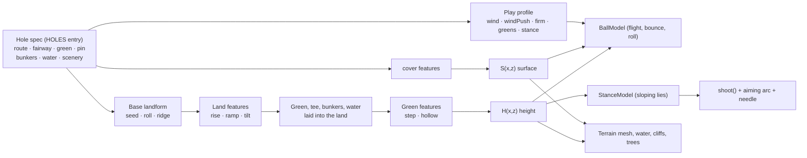

# Iconic holes: the design system

Build the system once; use it to bring many famous holes to life. This document is the architecture (what the system is) and the workflow (how to add a hole). Each hole then has its own spec in `docs/holes/`, written from `docs/holes/TEMPLATE.md`.

## 1. Architecture

A hole is **data**. Nothing in the engine knows any hole by name. The data goes through three layers, and every layer feeds the same height and surface functions that the renderer, the physics, the aiming arc and the tests all use, so a feature can never look one way and play another.

### 1.1 Terrain features (the catalogue)

Every feature does one thing inside an area with a soft edge. Areas are an ellipse `{x,z,rx,rz,rot}`, a polygon `{pts}`, or a band `{pts,w}` along a polyline; `edge` is the falloff in yards outside it. Coordinates are yards: the tee is at the origin, the hole plays toward +z, screen-left is +x.

| Type | Parameters | Use it for |
|---|---|---|
| `rise` | `area, dh, edge` | Plateaus, elevated greens and tees, knolls, shelves; `dh<0` sinks: hollows that drain to a hazard |
| `ramp` | `z0, z1, dh, area?, edge?` | The hole climbing or falling between two distances (uphill drive, downhill approach, valley) |
| `tilt` | `area, grade, edge` | Side slopes across the hole: `grade` yards of rise per yard toward screen-left (negative falls left) |
| `step` | `area, a, b, dh, w, edge` | Tiers and ridges: ground left of line a→b sits `dh` higher, over a ramp `w` wide |
| `hollow` | `area (ellipse), depth, edge, flat?` | Swales and bowls, on a green or anywhere. `depth<0` makes a crown; **`flat` (0–1) holds full depth over that share of the radius before it falls**, so a crown with `flat:0.6` is a plateau: a level top with steep edges (Pinehurst No. 2 #5). Default 0 is the original dome |
| `cover` | `area, surf, over?` | Turns rough (or the surfaces in `over`) into another surface: pine straw, a shaved bank, waste |

`rise`, `ramp` and `tilt` shape the land before the green, tee and bunkers are laid into it (an elevated green stays flat on top). `step` and `hollow` act after the green is laid, so they can contour the putting surface. Adding a type is one entry in `FEATURES` in `index.html` plus a test.

### 1.2 Other per-hole data

| Piece | Parameters | Notes |
|---|---|---|
| Water bodies | `kind` (ocean, creek, lake), `profile` (cliff, shore, wall), `shape` (outside, poly, band, ellipse), `islands` | A cliff profile drops straight to the sea; shore slopes to a creek whose level follows its banks; wall is a bulkhead |
| Obstacles (`obstacles`) | `type:'wall'`, `pts` (polyline), `t` thickness (1.2), `h` height (1.6), `e` restitution (0.3) | **Solid, registry-based (`OBSTACLES`).** Run through the BallModel `collide` hook on both flight and roll: a ball hits it, loses speed and is thrown back; a ball above `h` flies over. Add a type with one entry |
| Bunkers | `x,z,rx,rz,rot`, `depth` (default 0.9), `lip` (0.25) | Deep pot bunkers: depth 1.5+, lip 0.4+ |
| Green | ellipse, `tilt:{x,z}` plane slope, `pin` | Contours from `step`/`hollow` features |
| Surfaces | `SP` table: TEE, FAIRWAY, ROUGH, FRINGE, GREENS, SAND, WATER, PINE, **ROAD** (hard and fast, lie 0.80), **WASTE** (sandy waste area, grabs the ball, lie 0.82) | A new surface is one `SP` row, one name in `SURF`, one color in `colorAt` |

### 1.3 Shared gameplay systems

These are terrain-driven, so every hole gets them without asking:

- **StanceModel** (`// <stance-model>` in `index.html`). Reads the slope under the ball along the aim line. Ball above the feet starts left and hooks; below the feet, right and slicing; uphill flies higher and shorter; downhill lower and longer; any slope makes the needle swing faster (harder to time). The aiming arc includes the stance effect, so the arc never lies; there is no text label, the curving arc is the cue. The player answers with aim, a draw/fade pull, or a different club. Putts ignore it.
- **Play profile** (`play` on a hole): `wind:[min,max]` mph range; `windPush` for exposed holes (the HUD reads GUSTY); `firm` for fairway/rough run-out (links); `greens:{speed, firm}`; `stance` multiplier (0 turns sloping lies off). Each hole tunes its own copy of the surfaces; the next hole starts from the shared defaults.
- **BallModel** (unchanged from Phase 2): flight, impact and roll against whatever terrain and surfaces the hole produces. Elevation, run-outs, banks that feed water, and greens that shed balls all come from it.

### 1.4 What stays the same

Swing (SwingModel), the rainbow meter, mobile controls, scoring and the art style are untouched. The only engine changes outside the terrain code are: the stance effect wired into the shot, arc and needle; the wind range/push; the aim camera stepping in on downhill lies, keeping the ball in sight over rises and always above the bottom HUD; and the ground beyond the modelled area sitting below the hole's lowest point (valleys used to be covered by it).

## 2. Workflow: adding a famous hole

Each step produces something checked into the repo. `node tests/tools/validate.js <id>` runs the whole Validate step (6) for a hole; every tool in `tests/tools/` is described under "Tools" below.

1. **Research** → `docs/holes/<id>.md` §1–2. Read real sources; write down the real par and yardage (every figure the sources give, with the year if the hole has changed), the signature features and the one-sentence strategic problem. **If the par or yardage you were asked to build differs from what the sources say, write the mismatch in §1 as a question and ask before building** ("asked for par 4, 450 yd; every source says par 5, 576–588 yd since 2014: which one?"). Do not quietly pick one. If you cannot say what decision the hole forces, you are not ready to build it.
2. **Analyze** → §3. Tick the challenge archetypes and pick the primary one. That is what must survive translation.
3. **Translate** → §4 and the `HOLES` entry. Lay out the route, fairway, green and pin first (the straight line tee → pin is the yardage shown on the hole card), then add features from the catalogue, water, bunkers and a play profile. If a feature cannot be expressed, list it as a capability gap; do not special-case it in the engine.
4. **Exaggerate** → §5. Amplify the primary challenge until it decides real shots in our club distances (245/215/155/90 carry). Keep the shape recognizable; simplify the rest. **Exaggerate the decision, not the shape**: stay inside the realism bounds below, or say in §5 why this green is an exception.
5. **Implement** → write the hole's checks in `tests/hole-checks.js` *before* tuning: single shots with required outcomes, and strategies whose comparison must come out a certain way for sharp and shaky players. Then tune feature parameters until they pass. A check that has to change after tuning goes in §6's check-change log, with the reason.
6. **Validate** →
   - `node tests/tools/validate.js <id>`: the hole's checks, its map, its slope map and realism bounds, and its before/after report in one go
   - or one by one: `node --test tests/*.test.js` (all suites), `node tests/hole-map.js <id>` → `docs/maps/<id>.png` (surfaces, contours and the check shots traced: white = dry, red = water/OB, dot = first bounce), `node tests/tools/slope.js <id>` → `docs/maps/<id>-slope.png`, `node tests/hole-report.js --hole=<id>`
   - play it in the browser: `python3 tests/tools/render.py <id>` for the tee, bird's-eye and approach views (and the ball-versus-HUD numbers), then the key shot by hand.

### Realism bounds (step 4)

A hole should be hard in the way the real one is hard, not hard everywhere. Pinehurst No. 5's first green was a dome: the whole surface sloped, steepest halfway out ("a turtle shell"), so the hole had a decision but no putting surface. The default bounds, measured on the putting surface with `node tests/tools/slope.js <id>` (bands of a green-reading map: under 1 %, 1–2.5 %, 2.5–4 %, over 4 %):

| Bound | Default | Why |
|---|---|---|
| Falloff ring | no more than ~35 % of the surface steeper than 4 % | Steep ground belongs at the edges, where the real green sheds the ball |
| Top | mostly 1–2.5 % (at least half of the surface that is not steep), with some pockets under 1 % (5–40 % of the surface) | A top that putts like a green: gentle movement between flatter pockets, not a table and not a ramp |
| No full-green dome | not both: more than 60 % of the surface steeper than 2.5 % *and* slopes pointing every which way | A dome is steepest halfway out and has no flat top. A uniformly tilted plane (Augusta No. 13's back-to-front slope) is a different thing and is not flagged as one |

`slope.js` prints ok / WARN for each; `--strict` makes a WARN a non-zero exit. A WARN is a prompt, not a veto: look at the picture, then either reshape the green or write the reason in the spec's §5 (a real green that is one tilted plane has no flat pockets, and that is fine if the spec says so). The green's *shape* is not where to exaggerate. Exaggerate what the ball does at the edge and which shot the hole forces.

### Checks that say what the baseline can support (step 5)

Strategy checks compare plans using a simplified expected-strokes baseline (below). Write each one in terms of what that baseline can actually show, and quote it from `hole-report.js`: **hazard rate** (share in water/OB), **green rate** (share finishing on the putting surface), and **payoff gap** (strokes the aggressive plan saves over the safe one, for the sharp and the shaky player). Do not assert "X is the right play for a shaky player" unless the numbers show it: if the baseline calls it a wash, assert the rates and the gap and say so in the spec. Several holes are honest about this already (Augusta No. 12, Pinehurst No. 5).

When a check changes after tuning, log it in §6 of the spec (the template has the table): what it said, what it says now, and why. "It failed" is not a reason; "the baseline now charges the back bunkers, so the middle costs a shaky player 0.10 stroke where it used to cost 0.01" is.

### The expected-strokes baseline

`tests/hole-play.js` scores where a ball finishes with a tour-style table by distance to the pin, plus a lie charge (`LIE_ADD`: rough 0.18, sand 0.35, ...), plus a **recovery-difficulty term** read off the hole's real terrain, so that a hole does not need lie costs of its own:

| Part | Meaning |
|---|---|
| `up` | The face the ball has to climb: the highest ground within 10 yd along the line to the pin, above the ball (a bunker lip, a falloff, a shaved bank: a lie below the green edge), less a 1.0 yd allowance, since a normal bunker lip is already in the lie charge. 0.35 stroke per yard. An ordinary approach up to an elevated green from open fairway has no face and pays nothing |
| `short` | Short-sided: the pin is within 6 yd of the green's edge nearest the ball, and the ball is close to that edge. Up to 0.30 stroke; not charged on the fringe (you can putt it) |
| Reach | Full weight inside 45 yd of the pin, fading to nothing at 90 yd; balls on the green pay nothing (the putt table has them). The sum is capped at 1.0 stroke |

The constants were set from how much a recovery costs, not tuned to make any check pass. (The first version also charged "the pin's ground sits above the ball", which wrongly taxed every approach to an elevated green, including Pinehurst's lay-up; that part was dropped.) `evaluate()` reports the mean charge as `recovery`, and `opts.recovery:false` (or `--no-recovery` on `aimscan.js`) gives the previous distance-and-lie-only baseline for comparison.

`lieAdd` (a per-strategy override of the lie costs in `hole-checks.js`) remains as a **last resort** for a hazard the baseline still understates. No hole uses it now (St Andrews No. 17 did, for its bunker, until the recovery term made it unnecessary); if you reach for it, log it in §6.

### When the catalogue is not enough

Add the missing capability once, generically, and give it its own test in `tests/holes.test.js`. Phase 4 did this for St Andrews No. 17 and Pinehurst No. 2:

| Real feature | Expression |
|---|---|
| Road Hole Bunker (deep pot eating into the green) | bunker with `depth:2.8, lip:0.9` |
| The road behind the green | `ROAD` surface (one `SP` row, `lie:0.80`) via `cover` |
| The stone wall behind the road | `obstacles:[{type:'wall',...}]` via the `collide` hook, which now runs on the roll as well as in flight |
| Sandy waste areas | `WASTE` surface via `cover` |
| Plateau green with falloffs | `hollow` with negative `depth` and `flat` |
| Blind drive over the hotel corner, out of bounds along the hotel | **still a gap**: no blind-shot or side-OB primitive |
| A green with its true outline instead of an ellipse | **still a gap**, deliberately: `green:{pts}` would have to replace the ellipse in `H`, `S`, tree keep-out and the green mesh's shader, which draws the cut edge, the collar, the outline and the mowing from the ellipse. A polygon that plays one way and renders another breaks this system's one rule, so it was not worth the risk; rotate and size the ellipse, and say so in §4 |

### Tools (`tests/tools/`)

| Tool | What it does | Used in |
|---|---|---|
| `validate.js <id>` | Hole checks + map + slope map and bounds + that hole's report section, with a ✓/✗ summary | Step 6 |
| `probe.js <id> '<json shots>'` | Plays single shots and prints end, surface, yards to the pin, first bounce, stance, wall strikes | Steps 3–5: finding where a shot lands before writing the check |
| `aimscan.js <id> <from> <club> <x0,x1,z0,z1,step>` | Plays one shot at a grid of aim points as a sharp and a shaky player: expected strokes, green rate, wet rate | Steps 4–5: choosing an aim point and seeing how forgiving a target is |
| `slope.js <id>` | Green slope map (bands, contours, downhill arrows) and the realism bounds | Steps 4 and 6 |
| `render.py <id> [views]` | Real-game screenshots in headless Chromium (tee, bird's-eye, approach, green) and where the ball sits against the HUD | Step 6 |
| `card.py <n> <name> <par> <yards>` | A placeholder hole card in the card1–3 layout | After step 3, until real art exists |

Usage lines, flags and examples for each are at the top of the file and in `tests/README.md`.

### Environment notes

Things that bit in the sandbox and in shallow clones:

- **`hole-report` needs history.** It compares with `git show 548d49a:index.html`. In a shallow clone run `git fetch --unshallow` first (if the host refuses that, a bounded `git fetch --depth=1000 origin main` is enough). Without it the tool stops with that hint.
- **Fetch all branches.** A clone made with `--depth 1` or `--single-branch` only tracks `main`. Run `git config remote.origin.fetch '+refs/heads/*:refs/remotes/origin/*'` before fetching so other branches' history is there to compare against.
- **Open pull requests through the REST API.** The GraphQL API is blocked in the sandbox, so `gh pr create` fails. Use `gh api repos/<owner>/<repo>/pulls -f title=... -f head=<branch> -f base=main -f body=...`.
- **`render.py`** needs Python with `playwright` and its Chromium, and fetches three.js r128 once into `tests/tools/.cache/` (sparse clone of the `r128` tag, or `npm pack three@0.128.0`). WebGL is software, so a hole takes 10–60 s to build; nothing has run on a phone. `card.py` needs Pillow.
- **Node 18+** for everything else; no installs.
- **Project doc mirrors.** The Claude Project "The Fred" holds read-only copies of this file (`claude/iconic-holes-design-system.md`) and `docs/holes/TEMPLATE.md` (`claude/iconic-hole-template.md`), each headed with the source commit it was copied from. The repo is the source of truth: after merging a change to either file, re-copy it into the Project (`project_write`, same path, header updated to the new commit). Never edit the copies.

## 3. The holes so far

The first three are the Phase 3 proofs; holes 4–6 (Phase 4) were added with this workflow.

Chosen because they share almost nothing:

| Hole | Primary challenge | Mostly expressed by |
|---|---|---|
| [Pebble Beach No. 8](holes/pebble-8.md) | Distance control off the tee, then a forced carry over a chasm | `ramp` ×3, `rise`, `cover`, an ocean inlet in the cliff coastline |
| [Augusta No. 13](holes/augusta-13.md) | Risk/reward from a sidehill lie: go for it over the creek or lay up | `ramp` (speed slot), `tilt` + StanceModel, `rise` + `cover` (shaved bank), green speed |
| [TPC Sawgrass No. 17](holes/sawgrass-17.md) | Pure distance/direction control to an island, in the wind | `rise` (crowned island), `step` (tier), deep pot bunker, `windPush` |
| [St Andrews Old Course No. 17](holes/standrews-17.md) | Run-out to a green with a deep pot bunker, a road and a wall behind, on firm turf in wind | `ROAD`, `wall` obstacle, deep bunker, `firm`, wind |
| [Augusta National No. 12](holes/augusta-12.md) | Distance control over a creek to a shallow, wide, angled green in swirling wind | creek + shaved bank, `rise` ×2, bunkers front and back, `windPush` |
| [Pinehurst No. 2, No. 5](holes/pinehurst-5.md) | Par 5: go for an elevated plateau green from a sidehill lie, or lay up and wedge onto the top | plateau `hollow` (`flat`), `tilt` + StanceModel, runoffs + `WASTE` |
