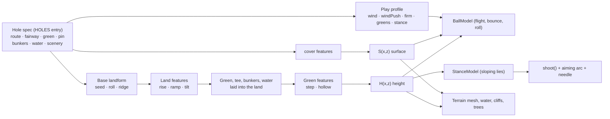

# Iconic holes: the design system

Build the system once; use it to bring many famous holes to life. This document is the architecture (what the system is) and the workflow (how to add a hole, and how to check it looks like the real one). Each hole then has its own spec in `docs/holes/`, written from `docs/holes/TEMPLATE.md`.

## 1. Architecture

A hole is **data**. Nothing in the engine knows any hole by name. The data goes through three layers, and every layer feeds the same height and surface functions that the renderer, the physics, the aiming arc and the tests all use, so a feature can never look one way and play another.

### 1.1 Terrain features (the catalogue)

Every feature does one thing inside an area with a soft edge. Areas are an ellipse `{x,z,rx,rz,rot}`, a polygon `{pts}`, or a band `{pts,w}` along a polyline; `edge` is the falloff in yards outside it. Coordinates are yards: the tee is at the origin, the hole plays toward +z, screen-left is +x.

| Type | Parameters | Use it for |
|---|---|---|
| `rise` | `area, dh, edge` | Plateaus, elevated greens and tees, knolls, shelves; `dh<0` sinks: hollows that drain to a hazard |
| `ramp` | `z0, z1, dh, area?, edge?` | The hole climbing or falling between two distances (uphill drive, downhill approach, valley) |
| `tilt` | `area, grade, edge` | Side slopes across the hole: `grade` yards of rise per yard toward screen-left (negative falls left) |
| `step` | `area, a, b, dh, w, edge` | Tiers and ridges: ground left of line a→b sits `dh` higher, over a ramp `w` wide |
| `hollow` | `area (ellipse), depth, edge, flat?` | Swales and bowls, on a green or anywhere. `depth<0` makes a crown; **`flat` (0–1) holds full depth over that share of the radius before it falls**, so a crown with `flat:0.6` is a plateau: a level top with steep edges (Pinehurst No. 2 #5). Default 0 is the original dome |
| `cover` | `area, surf, over?` | Turns rough (or the surfaces in `over`) into another surface: pine straw, a shaved bank, waste |

`rise`, `ramp` and `tilt` shape the land before the green, tee and bunkers are laid into it (an elevated green stays flat on top). `step` and `hollow` act after the green is laid, so they can contour the putting surface. Adding a type is one entry in `FEATURES` in `index.html` plus a test.

### 1.2 Other per-hole data

| Piece | Parameters | Notes |
|---|---|---|
| Water bodies | `kind` (ocean, creek, lake), `profile` (cliff, shore, wall), `shape` (outside, poly, band, ellipse), `islands` | A cliff profile drops straight to the sea; shore slopes to a creek whose level follows its banks; wall is a bulkhead |
| Obstacles (`obstacles`) | `type:'wall'`, `pts` (polyline), `t` thickness (1.2), `h` height (1.6), `e` restitution (0.3) | **Solid, registry-based (`OBSTACLES`).** Run through the BallModel `collide` hook on both flight and roll: a ball hits it, loses speed and is thrown back; a ball above `h` flies over. Add a type with one entry |
| Bunkers | an ellipse `x,z,rx,rz,rot`, **or a traced outline `pts:[[x,z],...]`**; `depth` (default 0.9), `lip` (0.25) | Deep pot bunkers: depth 1.5+, lip 0.4+ on an ellipse. A traced outline's walls are as wide as 0.45 of its inscribed radius, so a small or thin one needs less depth for the same wall: check it against the hop guard (Riviera No. 6 §5) |
| Green | an ellipse **or a traced outline `{pts}`**, `tilt:{x,z}` plane slope, `pin` | Contours from `step`/`hollow` features |
| Traced outlines | `pts` from `node tests/tools/trace.js <id> --snippet` | One number, `ell(x,z,shape)`, decides every green and bunker rule: heights, surfaces, colours, tree keep-out and the green's shader (fed per vertex). An outline reads 1 on its edge, 0 at its deepest point, and grows by 1 per `ro` yards outside (`ro`: the radius of a circle of the same area), so a fringe or a lip is as wide as on an ellipse of that size. `prepShape` in `index.html` |
| Surfaces | `SP` table: TEE, FAIRWAY, ROUGH, FRINGE, GREENS, SAND, WATER, PINE, **ROAD** (hard and fast, lie 0.80), **WASTE** (sandy waste area, grabs the ball, lie 0.82) | A new surface is one `SP` row, one name in `SURF`, one color in `colorAt` |

### 1.3 Shared gameplay systems

These are terrain-driven, so every hole gets them without asking:

- **StanceModel** (`// <stance-model>` in `index.html`). Reads the slope under the ball along the aim line. Ball above the feet starts left and hooks; below the feet, right and slicing; uphill flies higher and shorter; downhill lower and longer; any slope makes the needle swing faster (harder to time). The aiming arc includes the stance effect, so the arc never lies; there is no text label, the curving arc is the cue. The player answers with aim, a draw/fade pull, or a different club. Putts ignore it.
- **Play profile** (`play` on a hole): `wind:[min,max]` mph range; `windPush` for exposed holes (the HUD reads GUSTY); `firm` for fairway/rough run-out (links); `greens:{speed, firm}`; `stance` multiplier (0 turns sloping lies off). Each hole tunes its own copy of the surfaces; the next hole starts from the shared defaults.
- **BallModel** (unchanged from Phase 2): flight, impact and roll against whatever terrain and surfaces the hole produces. Elevation, run-outs, banks that feed water, and greens that shed balls all come from it.

### 1.4 What stays the same

Swing (SwingModel), the rainbow meter, mobile controls, scoring and the art style are untouched. The only engine changes outside the terrain code are: the stance effect wired into the shot, arc and needle; the wind range/push; the aim camera stepping in on downhill lies, keeping the ball in sight over rises and always above the bottom HUD; and the ground beyond the modelled area sitting below the hole's lowest point (valleys used to be covered by it).

## 2. Workflow: adding a famous hole

Each step produces something checked into the repo. `node tests/tools/validate.js <id>` runs the whole Validate step (6) for a hole; step 7, the visual review, checks it looks like the real one; every tool in `tests/tools/` is described under "Tools" below.

1. **Research** → `docs/holes/<id>.md` §1–2. Read real sources; write down the real par and yardage (every figure the sources give, with the year if the hole has changed), the signature features and the one-sentence strategic problem. **If the par or yardage you were asked to build differs from what the sources say, write the mismatch in §1 as a question and ask before building** ("asked for par 4, 450 yd; every source says par 5, 576–588 yd since 2014: which one?"). Do not quietly pick one. If you cannot say what decision the hole forces, you are not ready to build it.
2. **Analyze** → §3. Tick the challenge archetypes and pick the primary one. That is what must survive translation.
3. **Translate** → §4 and the `HOLES` entry. Lay out the route, fairway, green and pin first (the straight line tee → pin is the yardage shown on the hole card), then add features from the catalogue, water, bunkers and a play profile. If a feature cannot be expressed, list it as a capability gap; do not special-case it in the engine. **If you have a photo, trace it first** (step 7's tools) and lay the green and bunkers from the tracing: shapes from the photo, decisions from the sources.
4. **Exaggerate** → §5. Amplify the primary challenge until it decides real shots in our club distances (245/215/155/90 carry). Keep the shape recognizable; simplify the rest. **Exaggerate the decision, not the shape**: stay inside the realism bounds below, or say in §5 why this green is an exception.
5. **Implement** → write the hole's checks in `tests/hole-checks.js` *before* tuning: single shots with required outcomes, and strategies whose comparison must come out a certain way for sharp and shaky players. Then tune feature parameters until they pass. A check that has to change after tuning goes in §6's check-change log, with the reason.
6. **Validate** →
   - `node tests/tools/validate.js <id>`: the hole's checks, its map, its slope map and realism bounds, and its before/after report in one go
   - or one by one: `node --test tests/*.test.js` (all suites), `node tests/hole-map.js <id>` → `docs/maps/<id>.png` (surfaces, contours and the check shots traced: white = dry, red = water/OB, dot = first bounce), `node tests/tools/slope.js <id>` → `docs/maps/<id>-slope.png`, `node tests/hole-report.js --hole=<id>`
   - play it in the browser: `python3 tests/tools/render.py <id>` for the tee, bird's-eye and approach views (and the ball-versus-HUD numbers), then the key shot by hand.

7. **Visual review** → `docs/holes/trace/<id>.json` and the spec's §8. The checks say the hole plays as designed; this says it looks like the real one, and lists what does not.
   - **Reference images.** At least one per hole: an aerial of the green complex traces best; a photo from the tee is the second, and fixes direction (Riviera No. 6 needed both). **Photos are never committed**: they are other people's pictures. Keep them in `tests/tools/refs/` (git-ignored; the repo's `.gitignore` also refuses images in `docs/holes/trace/` and side-by-sides in `docs/maps/`). The trace file records each by file name, size, sha256 and source, so anyone can tell whether they have the same photo.
   - **Trace.** In the photo's own pixels: outlines (`python3 tests/tools/trace_photo.py fill <photo> u,v` floods bright sand; `grid` gives a gridded zoom for tracing a green by hand), and camera constraints: a `point` whose hole coordinates you decide (keep a feature the checks are built around where it is), a `vertical` of known height for scale (a flagstick: 7–8 ft, times the hole's length scale), and **landmarks** seen in two photos, whose positions the fit solves for. `trace_photo.py show <id>` draws it all back on the photo to check.
   - **Fit and back-project.** `node tests/tools/trace.js <id>` fits every photo's camera together (position, yaw, pitch, roll, field of view; principal point at the photo's centre) by least squares, holding what the file says to hold, and prints each constraint's residual in pixels. It says how many equations spare there are: with none, the residual checks nothing. It then lays each outline on the hole's land and compares it with the shape the hole has (`--ref=<commit>` for the hole as it was): width, depth, area, centroid, overlap. A `sensitivity` list in the file reruns the fit under each assumption changed (a held parameter moved, a constraint dropped or added) and shows how far the outlines move; a run whose residual jumps is ruled out. A photo taken from far away (a tee shot of a green 140 yd off) cannot place its own camera: hold its position and use it for directions only, as Riviera's tee photo is; its heights are not measurable that way either. `--write` stores the cameras and outlines in the file; `--snippet` prints the `pts` for `index.html`. An outline drawn bigger or moved on purpose says so in the file (`exaggerate: {scale, shift}`) and in §5: **exaggerate the decision, not the shape** still holds, so it is the exception.
   - **Matched renders.** `python3 tests/tools/render.py <id> ref --out docs/maps`: the game seen from each photo's camera, at the photo's shape, HUD hidden, the outlines drawn on top (commit these). With the photos at hand it also writes side-by-sides to `tests/tools/out/` (never committed: they contain the photo). `aerial` is the same kind of picture for a hole with no photo yet.
   - **Sign-off checklist** (§8 of the spec, from the template): tee placement and elevation, fairway and fairway bunkers, green and greenside bunkers, surroundings and landmarks, one verdict per row: **matches**, **close**, **differs: fix** (expressible now; say whether it changes play, and then it needs checks), **differs on purpose** (§5), **can't express yet** (name the primitive) or **no reference** (say which photo would show it). Then the open items, most important first.
   - A hole without photos still gets a **review-only** pass: the same table against the renders and the sources, with no shape measured. It says which photos to get.

### Realism bounds (step 4)

A hole should be hard in the way the real one is hard, not hard everywhere. Pinehurst No. 5's first green was a dome: the whole surface sloped, steepest halfway out ("a turtle shell"), so the hole had a decision but no putting surface. The default bounds, measured on the putting surface with `node tests/tools/slope.js <id>` (bands of a green-reading map: under 1 %, 1–2.5 %, 2.5–4 %, over 4 %):

| Bound | Default | Why |
|---|---|---|
| Falloff ring | no more than ~35 % of the surface steeper than 4 % | Steep ground belongs at the edges, where the real green sheds the ball |
| Top | mostly 1–2.5 % (at least half of the surface that is not steep), with some pockets under 1 % (5–40 % of the surface) | A top that putts like a green: gentle movement between flatter pockets, not a table and not a ramp |
| No full-green dome | not both: more than 60 % of the surface steeper than 2.5 % *and* slopes pointing every which way | A dome is steepest halfway out and has no flat top. A uniformly tilted plane (Augusta No. 13's back-to-front slope) is a different thing and is not flagged as one |

`slope.js` prints ok / WARN for each; `--strict` makes a WARN a non-zero exit. A WARN is a prompt, not a veto: look at the picture, then either reshape the green or write the reason in the spec's §5 (a real green that is one tilted plane has no flat pockets, and that is fine if the spec says so). The green's *shape* is not where to exaggerate. Exaggerate what the ball does at the edge and which shot the hole forces.

### Checks that say what the baseline can support (step 5)

Strategy checks compare plans using a simplified expected-strokes baseline (below). Write each one in terms of what that baseline can actually show, and quote it from `hole-report.js`: **hazard rate** (share in water/OB), **green rate** (share finishing on the putting surface), and **payoff gap** (strokes the aggressive plan saves over the safe one, for the sharp and the shaky player). Do not assert "X is the right play for a shaky player" unless the numbers show it: if the baseline calls it a wash, assert the rates and the gap and say so in the spec. Several holes are honest about this already (Augusta No. 12, Pinehurst No. 5).

When a check changes after tuning, log it in §6 of the spec (the template has the table): what it said, what it says now, and why. "It failed" is not a reason; "the baseline now charges the back bunkers, so the middle costs a shaky player 0.10 stroke where it used to cost 0.01" is.

### What the tools cannot see (found on Riviera No. 6)

- **Putts.** `playShot` cannot play a Putter: it has no launch arc, so the aim-power search returns NaN. Any recovery that is a putt (around a bunker, across a tier) is neither tested nor priced. Write such a hole's checks around shots that can be played, and say so in §4's capability gaps.
- **The green is priced by distance alone.** A ball on the putting surface pays `PUTT[distance to the pin]` whichever quadrant it is in, and the recovery term returns 0 for it. A bunker, a tier or a false front *inside* the green changes the baseline only when a ball finishes in the bunker. Count how many green finishes have a hazard on the straight line to the pin (Riviera No. 6: 20 of 21 for the bail-out plan) and write what the baseline under-charges in the spec's §6, as a bound on the gap, not as a score.
- **A bunker's charge follows its depth, so changing a bunker for a physics reason changes the strategy numbers.** The recovery term charges 0.35 per yard of face above the 1.0 yd allowance; softening Riviera's back bunker to pass the hop guard in `tests/ball.test.js` took its charge from 0.55 to 0.46.

### The expected-strokes baseline

`tests/hole-play.js` scores where a ball finishes with a tour-style table by distance to the pin, plus a lie charge (`LIE_ADD`: rough 0.18, sand 0.35, ...), plus a **recovery-difficulty term** read off the hole's real terrain, so that a hole does not need lie costs of its own:

| Part | Meaning |
|---|---|
| `up` | The face the ball has to climb: the highest ground within 10 yd along the line to the pin, above the ball (a bunker lip, a falloff, a shaved bank: a lie below the green edge), less a 1.0 yd allowance, since a normal bunker lip is already in the lie charge. 0.35 stroke per yard. An ordinary approach up to an elevated green from open fairway has no face and pays nothing |
| `short` | Short-sided: the pin is within 6 yd of the green's edge nearest the ball, and the ball is close to that edge. Up to 0.30 stroke; not charged on the fringe (you can putt it) |
| Reach | Full weight inside 45 yd of the pin, fading to nothing at 90 yd; balls on the green pay nothing (the putt table has them). The sum is capped at 1.0 stroke |

The constants were set from how much a recovery costs, not tuned to make any check pass. (The first version also charged "the pin's ground sits above the ball", which wrongly taxed every approach to an elevated green, including Pinehurst's lay-up; that part was dropped.) `evaluate()` reports the mean charge as `recovery`, and `opts.recovery:false` (or `--no-recovery` on `aimscan.js`) gives the previous distance-and-lie-only baseline for comparison.

`lieAdd` (a per-strategy override of the lie costs in `hole-checks.js`) remains as a **last resort** for a hazard the baseline still understates. No hole uses it now (St Andrews No. 17 did, for its bunker, until the recovery term made it unnecessary); if you reach for it, log it in §6.

### When the catalogue is not enough

Add the missing capability once, generically, and give it its own test in `tests/holes.test.js`. Phase 4 did this for St Andrews No. 17 and Pinehurst No. 2:

| Real feature | Expression |
|---|---|
| Road Hole Bunker (deep pot eating into the green) | bunker with `depth:2.8, lip:0.9` |
| The road behind the green | `ROAD` surface (one `SP` row, `lie:0.80`) via `cover` |
| The stone wall behind the road | `obstacles:[{type:'wall',...}]` via the `collide` hook, which now runs on the roll as well as in flight |
| Sandy waste areas | `WASTE` surface via `cover` |
| Plateau green with falloffs | `hollow` with negative `depth` and `flat` |
| Blind drive over the hotel corner, out of bounds along the hotel | **still a gap**: no blind-shot or side-OB primitive |
| A green or a bunker with its true outline instead of an ellipse | **traced outlines** (`green:{pts}`, `bunkers:[{pts,...}]`), added with the visual review for Riviera No. 6: `prepShape` gives an outline the same `ell()` the ellipse has, and the green's shader now takes `ell` per vertex instead of computing the ellipse itself, so an outline cannot play one way and render another. Existing ellipse greens render as before (0.08 % of pixels differ, at the anti-aliased edge) |

### Tools (`tests/tools/`)

| Tool | What it does | Used in |
|---|---|---|
| `validate.js <id>` | Hole checks + map + slope map and bounds + that hole's report section, with a ✓/✗ summary | Step 6 |
| `probe.js <id> '<json shots>'` | Plays single shots and prints end, surface, yards to the pin, first bounce, stance, wall strikes | Steps 3–5: finding where a shot lands before writing the check |
| `aimscan.js <id> <from> <club> <x0,x1,z0,z1,step>` | Plays one shot at a grid of aim points as a sharp and a shaky player: expected strokes, green rate, wet rate | Steps 4–5: choosing an aim point and seeing how forgiving a target is |
| `slope.js <id>` | Green slope map (bands, contours, downhill arrows) and the realism bounds | Steps 4 and 6 |
| `render.py <id> [views]` | Real-game screenshots in headless Chromium (tee, bird's-eye, approach, green) and where the ball sits against the HUD | Step 6 |
| `card.py <n> <name> <par> <yards>` | A placeholder hole card in the card1–3 layout | After step 3, until real art exists |
| `trace_photo.py grid / fill / show / hash` | Reads outlines off a reference photo: a gridded zoom to trace by hand, a flood fill that returns a region's outline, the trace file drawn back on the photo, a photo's size and sha256 (Pillow) | Step 7 |
| `trace.js <id> [--write] [--snippet] [--ref=<commit>]` | Fits each photo's camera, solves the landmarks, lays the outlines on the hole's land; residuals, the comparison with the hole's shapes and the sensitivity runs | Steps 3 and 7 |
| `render.py <id> ref` / `aerial` | The game from each photo's matched camera with the outlines on top (and side-by-sides with the photo, kept out of the repo); `aerial`: the green complex from a drone's height, for holes with no photo | Step 7 |

Usage lines, flags and examples for each are at the top of the file and in `tests/README.md`.

### Environment notes

Things that bit in the sandbox and in shallow clones:

- **`hole-report` needs history.** It compares with `git show 548d49a:index.html`. In a shallow clone run `git fetch --unshallow` first (if the host refuses that, a bounded `git fetch --depth=1000 origin main` is enough). Without it the tool stops with that hint.
- **Fetch all branches.** A clone made with `--depth 1` or `--single-branch` only tracks `main`. Run `git config remote.origin.fetch '+refs/heads/*:refs/remotes/origin/*'` before fetching so other branches' history is there to compare against.
- **Open pull requests through the REST API.** The GraphQL API is blocked in the sandbox, so `gh pr create` fails. Use `gh api repos/<owner>/<repo>/pulls -f title=... -f head=<branch> -f base=main -f body=...`.
- **`render.py`** needs Python with `playwright` and its Chromium, and fetches three.js r128 once into `tests/tools/.cache/` (sparse clone of the `r128` tag, or `npm pack three@0.128.0`). WebGL is software, so a hole takes 10–60 s to build; nothing has run on a phone. `card.py` needs Pillow.
- **`trace_photo.py`** needs Pillow; put reference photos in `tests/tools/refs/` under the `image.file` name their trace file gives (the folder is git-ignored).
- **Node 18+** for everything else; no installs.
- **Project doc mirrors.** The Claude Project "The Fred" holds read-only copies of this file (`claude/iconic-holes-design-system.md`) and `docs/holes/TEMPLATE.md` (`claude/iconic-hole-template.md`), each headed with the source commit it was copied from. The repo is the source of truth: after merging a change to either file, re-copy it into the Project (`project_write`, same path, header updated to the new commit). Never edit the copies.

## 3. The holes so far

The first three are the Phase 3 proofs; holes 4–7 (Phase 4 and after) were added with this workflow.

Chosen because they share almost nothing:

| Hole | Primary challenge | Mostly expressed by | Visual review (§8 of its spec) |
|---|---|---|---|
| [Pebble Beach No. 8](holes/pebble-8.md) | Distance control off the tee, then a forced carry over a chasm | `ramp` ×3, `rise`, `cover`, an ocean inlet in the cliff coastline | review-only: no photo yet |
| [Augusta No. 13](holes/augusta-13.md) | Risk/reward from a sidehill lie: go for it over the creek or lay up | `ramp` (speed slot), `tilt` + StanceModel, `rise` + `cover` (shaved bank), green speed | review-only: no photo yet |
| [TPC Sawgrass No. 17](holes/sawgrass-17.md) | Pure distance/direction control to an island, in the wind | `rise` (crowned island), `step` (tier), deep pot bunker, `windPush` | review-only: no photo yet |
| [St Andrews Old Course No. 17](holes/standrews-17.md) | Run-out to a green with a deep pot bunker, a road and a wall behind, on firm turf in wind | `ROAD`, `wall` obstacle, deep bunker, `firm`, wind | review-only: no photo yet |
| [Augusta National No. 12](holes/augusta-12.md) | Distance control over a creek to a shallow, wide, angled green in swirling wind | creek + shaved bank, `rise` ×2, bunkers front and back, `windPush` | review-only: no photo yet |
| [Pinehurst No. 2, No. 5](holes/pinehurst-5.md) | Par 5: go for an elevated plateau green from a sidehill lie, or lay up and wedge onto the top | plateau `hollow` (`flat`), `tilt` + StanceModel, runoffs + `WASTE` | review-only: no photo yet |
| [Riviera No. 6](holes/riviera-6.md) | Par 3: the decision is the pin, not the club: a bunker in the middle of the green, a tier between the two pin areas, a big bunker short and small ones behind and off the left end | the green and four bunkers **traced from two photos** (the middle bunker ×2 on purpose), `step` + `hollow` + `tilt` on the green | **traced and signed off** on the green and its bunkers: aerial + tee photo, rms 1.1 px |

### 3.1 What the visual review found, ranked

Riviera No. 6 was reviewed against two photos; the other six had review-only passes (renders against their sources). Ranked by how much a gap changes the hole a player meets, across holes, then by how cheaply it closes:

| # | Gap | Holes | Kind | Changes play? | Next step |
|---|---|---|---|---|---|
| 1 | **Green and bunker shapes are written-source guesses.** On Riviera the tracing found the green 50 % too big, the middle bunker 3.5 × too wide, the back bunker 4.6 × too big, the "front-left" bunker 12 yd out of place and a fourth bunker missing. The other six greens and their bunkers are still ellipses placed from words | all six untraced | **expressible now** (traced outlines) | yes: the shot each hole is about; checks may need retuning, as Riviera's did | one aerial of each green complex; trace, re-run the hole's checks |
| 2 | **Heights are design guesses.** Riviera's raised tee, the dip and the bank behind the green; Pebble's climb, chasm and green knoll; the fall into Augusta No. 13's corner; Pinehurst's rise. A photo taken from 120 yd or more cannot measure them (Riviera's tee-photo fit runs away when asked) | Riviera, Pebble, Augusta 13, Pinehurst | expressible (`ramp`, `rise`); **data missing** | yes | heights from a topographic source or a side-on photo; Riviera's bank behind the green first (it decides what a long miss meets) |
| 3 | **Blind shots and side out-of-bounds.** St Andrews' drive over the sheds with OB along the hotel is played as an open fairway; Pebble's blind drive has no aiming rock | St Andrews, Pebble | **can't express yet**: a blind-shot primitive (what the player sees from the tee) and an OB line | yes: St Andrews' first shot is not the real one | design the two primitives once, generically |
| 4 | **Buildings and backdrops.** Riviera's hedge and houses on the hill (its signature view), St Andrews' hotel and sheds. The game has one building, a red-roofed `clubhouse`, one per hole | Riviera, St Andrews | **can't express yet**: a building prop (size, colour, count, on raised ground) and a hedge | no (look only) | one generic prop, then place from the photos |
| 5 | **Deep bunkers in traced shapes.** A traced bunker's walls are steeper than an ellipse's at the same depth, and the ball model bounces off steep sand faces, so Riviera's front and middle bunkers are shallower than the real ones to pass the hop guard | Riviera now; St Andrews' Road Hole Bunker when traced | **can't express yet**: a sand face that takes the pace off a ball (plugging, or a soft lip) | yes: recovery from the sand | a BallModel change with its own tests |
| 6 | Small things that are expressible now: Sawgrass' walkway (a band island), the side of Augusta No. 12's Hogan Bridge (data, to confirm), Riviera's cart path (a `cover` band) and its trees where the photos have them (tree zones) | Sawgrass, Augusta 12, Riviera | **expressible now** | no | do with each hole's photos |
| 7 | Cosmetic primitives: a sycamore tree type; a per-hole switch for the rocks scattered in every hole's rough | Riviera (the rocks: every hole) | **can't express yet** | no | when convenient |
