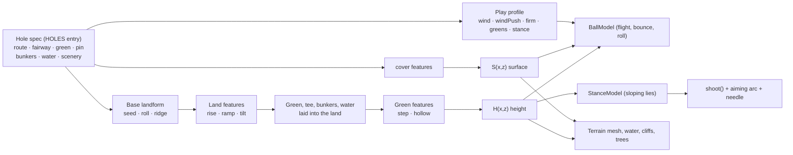

# Iconic holes: the design system

Build the system once; use it to bring many famous holes to life. This document is the architecture (what the system is) and the workflow (how to add a hole). Each hole then has its own spec in `docs/holes/`, written from `docs/holes/TEMPLATE.md`.

## 1. Architecture

A hole is **data**. Nothing in the engine knows any hole by name. The data goes through three layers, and every layer feeds the same height and surface functions that the renderer, the physics, the aiming arc and the tests all use, so a feature can never look one way and play another.

### 1.1 Terrain features (the catalogue)

Every feature does one thing inside an area with a soft edge. Areas are an ellipse `{x,z,rx,rz,rot}`, a polygon `{pts}`, or a band `{pts,w}` along a polyline; `edge` is the falloff in yards outside it. Coordinates are yards: the tee is at the origin, the hole plays toward +z, screen-left is +x.

| Type | Parameters | Use it for |
|---|---|---|
| `rise` | `area, dh, edge` | Plateaus, elevated greens and tees, knolls, shelves; `dh<0` sinks: hollows that drain to a hazard |
| `ramp` | `z0, z1, dh, area?, edge?` | The hole climbing or falling between two distances (uphill drive, downhill approach, valley) |
| `tilt` | `area, grade, edge` | Side slopes across the hole: `grade` yards of rise per yard toward screen-left (negative falls left) |
| `step` | `area, a, b, dh, w, edge` | Tiers and ridges: ground left of line a→b sits `dh` higher, over a ramp `w` wide |
| `hollow` | `area (ellipse), depth, edge, flat?` | Swales and bowls, on a green or anywhere. `depth<0` makes a crown; **`flat` (0–1) holds full depth over that share of the radius before it falls**, so a crown with `flat:0.6` is a plateau: a level top with steep edges (Pinehurst No. 2 #5). Default 0 is the original dome |
| `cover` | `area, surf, over?` | Turns rough (or the surfaces in `over`) into another surface: pine straw, a shaved bank, waste |

`rise`, `ramp` and `tilt` shape the land before the green, tee and bunkers are laid into it (an elevated green stays flat on top). `step` and `hollow` act after the green is laid, so they can contour the putting surface. Adding a type is one entry in `FEATURES` in `index.html` plus a test.

### 1.2 Other per-hole data

| Piece | Parameters | Notes |
|---|---|---|
| Water bodies | `kind` (ocean, creek, lake), `profile` (cliff, shore, wall), `shape` (outside, poly, band, ellipse), `islands` | A cliff profile drops straight to the sea; shore slopes to a creek whose level follows its banks; wall is a bulkhead |
| Obstacles (`obstacles`) | `type:'wall'`, `pts` (polyline), `t` thickness (1.2), `h` height (1.6), `e` restitution (0.3) | **Solid, registry-based (`OBSTACLES`).** Run through the BallModel `collide` hook on both flight and roll: a ball hits it, loses speed and is thrown back; a ball above `h` flies over. Add a type with one entry |
| Bunkers | `x,z,rx,rz,rot`, `depth` (default 0.9), `lip` (0.25) | Deep pot bunkers: depth 1.5+, lip 0.4+ |
| Green | ellipse, `tilt:{x,z}` plane slope, `pin` | Contours from `step`/`hollow` features |
| Surfaces | `SP` table: TEE, FAIRWAY, ROUGH, FRINGE, GREENS, SAND, WATER, PINE, **ROAD** (hard and fast, lie 0.80), **WASTE** (sandy waste area, grabs the ball, lie 0.82) | A new surface is one `SP` row, one name in `SURF`, one color in `colorAt` |

### 1.3 Shared gameplay systems

These are terrain-driven, so every hole gets them without asking:

- **StanceModel** (`// <stance-model>` in `index.html`). Reads the slope under the ball along the aim line. Ball above the feet starts left and hooks; below the feet, right and slicing; uphill flies higher and shorter; downhill lower and longer; any slope makes the needle swing faster (harder to time). The aiming arc includes the stance effect, so the arc never lies; there is no text label, the curving arc is the cue. The player answers with aim, a draw/fade pull, or a different club. Putts ignore it.
- **Play profile** (`play` on a hole): `wind:[min,max]` mph range; `windPush` for exposed holes (the HUD reads GUSTY); `firm` for fairway/rough run-out (links); `greens:{speed, firm}`; `stance` multiplier (0 turns sloping lies off). Each hole tunes its own copy of the surfaces; the next hole starts from the shared defaults.
- **BallModel** (unchanged from Phase 2): flight, impact and roll against whatever terrain and surfaces the hole produces. Elevation, run-outs, banks that feed water, and greens that shed balls all come from it.

### 1.4 What stays the same

Swing (SwingModel), the rainbow meter, mobile controls, scoring and the art style are untouched. The only engine changes outside the terrain code are: the stance effect wired into the shot, arc and needle; the wind range/push; the aim camera stepping in on downhill lies, keeping the ball in sight over rises and always above the bottom HUD; and the ground beyond the modelled area sitting below the hole's lowest point (valleys used to be covered by it).

## 2. Workflow: adding a famous hole

Each step produces something checked into the repo.

1. **Research** → `docs/holes/<id>.md` §1–2. Read real sources; write down yardage, signature features and the one-sentence strategic problem. If you cannot say what decision the hole forces, you are not ready to build it.
2. **Analyze** → §3. Tick the challenge archetypes and pick the primary one. That is what must survive translation.
3. **Translate** → §4 and the `HOLES` entry. Lay out the route, fairway, green and pin first (the straight line tee → pin is the yardage shown on the hole card), then add features from the catalogue, water, bunkers and a play profile. If a feature cannot be expressed, list it as a capability gap; do not special-case it in the engine.
4. **Exaggerate** → §5. Amplify the primary challenge until it decides real shots in our club distances (245/215/155/90 carry). Keep the shape recognizable; simplify the rest.
5. **Implement** → write the hole's checks in `tests/hole-checks.js` *before* tuning: single shots with required outcomes, and strategies whose comparison must come out a certain way for sharp and shaky players. Then tune feature parameters until they pass.
6. **Validate** →
   - `node --test tests/*.test.js` (all suites, including the hole's checks)
   - `node tests/hole-map.js <id>` → `docs/maps/<id>.png`: surfaces, contours and the check shots traced (white = dry, red = water/OB, dot = first bounce)
   - `node tests/hole-report.js` → the hole's before/after table
   - play it in the browser: tee view, bird's-eye, and the key shot.

### When the catalogue is not enough

Add the missing capability once, generically, and give it its own test in `tests/holes.test.js`. Phase 4 did this for St Andrews No. 17 and Pinehurst No. 2:

| Real feature | Expression |
|---|---|
| Road Hole Bunker (deep pot eating into the green) | bunker with `depth:2.8, lip:0.9` |
| The road behind the green | `ROAD` surface (one `SP` row, `lie:0.80`) via `cover` |
| The stone wall behind the road | `obstacles:[{type:'wall',...}]` via the `collide` hook, which now runs on the roll as well as in flight |
| Sandy waste areas | `WASTE` surface via `cover` |
| Plateau green with falloffs | `hollow` with negative `depth` and `flat` |
| Blind drive over the hotel corner, out of bounds along the hotel | **still a gap**: no blind-shot or side-OB primitive |

Test-only knob: a hole's strategy may set `lieAdd:{SAND:1.0}` in `hole-checks.js` to charge a lie more than the shared baseline does (a bunker you cannot play out of forwards).

## 3. The holes so far

The first three are the Phase 3 proofs; holes 4–6 (Phase 4) were added with this workflow.

Chosen because they share almost nothing:

| Hole | Primary challenge | Mostly expressed by |
|---|---|---|
| [Pebble Beach No. 8](holes/pebble-8.md) | Distance control off the tee, then a forced carry over a chasm | `ramp` ×3, `rise`, `cover`, an ocean inlet in the cliff coastline |
| [Augusta No. 13](holes/augusta-13.md) | Risk/reward from a sidehill lie: go for it over the creek or lay up | `ramp` (speed slot), `tilt` + StanceModel, `rise` + `cover` (shaved bank), green speed |
| [TPC Sawgrass No. 17](holes/sawgrass-17.md) | Pure distance/direction control to an island, in the wind | `rise` (crowned island), `step` (tier), deep pot bunker, `windPush` |
| [St Andrews Old Course No. 17](holes/standrews-17.md) | Run-out to a green with a deep pot bunker, a road and a wall behind, on firm turf in wind | `ROAD`, `wall` obstacle, deep bunker, `firm`, wind |
| [Augusta National No. 12](holes/augusta-12.md) | Distance control over a creek to a shallow, wide, angled green in swirling wind | creek + shaved bank, `rise` ×2, bunkers front and back, `windPush` |
| [Pinehurst No. 2, No. 5](holes/pinehurst-5.md) | Par 5: go for an elevated plateau green from a sidehill lie, or lay up and wedge onto the top | plateau `hollow` (`flat`), `tilt` + StanceModel, runoffs + `WASTE` |
