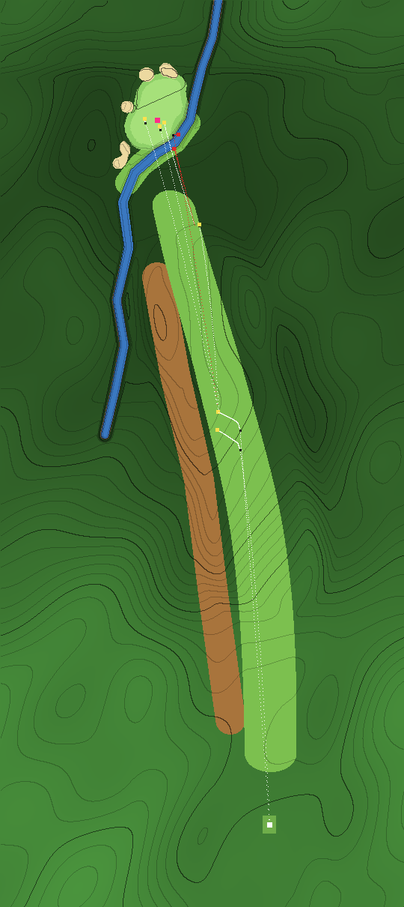

# Iconic hole spec: Augusta National No. 13 (Azalea)



## 1. Inspiration

| | |
|---|---|
| Real hole | Augusta National Golf Club, No. 13 "Azalea" |
| Par / yardage (real) | Par 5, 545 yards (lengthened in 2023) |
| Par / yardage (game) | Par 5, **476 yards** since the OpenFairway physics (2026-10-21: the tee 100 yd forward and softer turf, §6; `cards/card2.jpg`'s tag reads 476y); 575 before |
| Sources | [Golf Digest on the 2023 lengthening and strategy](https://www.golfdigest.com/story/masters2023-13th-hole-augusta-national-lengthened-how-does-it-compare-strategy) |

## 2. What makes it iconic

- **Signature features**: a sharp dogleg left wrapped by a tributary of Rae's Creek, which then crosses in front of the green; azaleas; pines on the left of the corner.
- **The strategic problem**: Bobby Jones called the second shot a "momentous decision" — go for the green with a long club over the creek, or lay up. The second is typically played from a sidehill lie. Off the tee, players hug the left: a drive out to the right leaves a long second.
- **Where scores are made and lost**: eagles for those who get home, doubles for those who find the creek.

## 3. Analysis

| Archetype | Applies? | Shot | Notes |
|---|---|---|---|
| Risk/reward split | **primary** | second | go vs. lay up |
| Sloping lies | **primary** | second | ball above the feet, hooking toward the creek |
| Dogleg / corner | yes | tee | left is shorter, closer to trouble |
| Elevation change | yes | tee | the drive runs down into a valley |
| Penal surrounds | yes | second, third | creek in front, bank feeding it |
| Fast greens | yes | putt | |

## 4. Translation

| Real feature | Game expression | Parameters | What it does to play |
|---|---|---|---|
| Drive kicks down into the corner | `ramp` (speed slot) | z 90→260, −14.5 yd (not the lidar: §5) | since the tee moved (§6) the drive flies most of it and lands at its foot: a pure driver finishes 199 from the pin, a drawn one 210 |
| Soft parkland turf | `play.firm` 0.6 (rolling friction and grab on tee, fairway, rough and fringe ×1.7) | the whole hole | a drive grips the sidehill where it lands instead of running off it to the low line (§6); the shaved bank still sheds a ball into the creek |
| From the corner to the green | six `ramp`s from the 2018 USGS lidar (`lidar.py build`) | z 233→414 −3.5 yd to the creek, +2.4 up to the green, +5.3 over the bank behind | the second plays slightly downhill to a green 2 m above the creek |
| Sidehill second shot | `tilt` + **StanceModel** | band along the fairway z 180–355, grade −0.11 (falls left) | ball above the feet: the arc and the shot hook left, toward the creek; the needle swings faster |
| Pine straw left of the corner | `cover` → PINE (new surface) | band left of the fairway | lie costs 20% distance |
| The tributary | water body (`creek`, `shore`) | a band along the lidar's lowest line: up the left, across the front of the green, up its right side | short or right of the green is wet; the lay-up area right of the creek stays dry |
| Green above a shaved bank | the lidar ramp + `cover` → FAIRWAY | a mown band 8 yd wide between the creek and the green | anything short rolls back into the water |
| The green and its bunkers | traced outline (`pts`) from a top-down rendering placed by its four bunkers on the lidar; bunkers from the lidar (two `build` outlines, two 3 m hollows) | green 36 × 45 yd, 1116 yd²; bunkers 0.45–0.55 yd deep: a kidney front-left, one left, two behind | long or left finds sand, not rough |
| Fast green toward the creek | `greens.speed` 1.25, `tilt` from the lidar plane | x +1.37 %, z +3.03 % (it falls toward the front and the creek) | a ball landing on the front feeds back down the bank |

**Capability gaps**: the real green's swales (could use `hollow`); tree collision is in the game but not in the Node tests.

## 5. Exaggeration

| Characteristic | Real | Game | Why |
|---|---|---|---|
| Speed slot | the real drive climbs about 15 m from the tee to the corner (lidar) | a 14.5-yd fall, z 90→260 (190→360 before the tee moved); a pure drive finishes 199 from the pin | our clubs are short, and the game's first leg is 62 yd longer than the real one (a gentle bend, not a sharp dogleg): without the slot the green is never reachable in two and the decision disappears. Chosen by the project owner over real heights here (2026-10-20). Since the OpenFairway physics the tee move does most of that work; the slot stays as the valley the drive flies into |
| Length | 545 yd | 476 yd (575 before 2026-10-21) | a driver rolls 10 yd on flat fairway now (main 41) and cannot run down the sidehill and stop on it, so the tee moved to where a drive lands at the valley's foot |
| Turf | firm and fast (Augusta) | softer (`play.firm` 0.6) | the only data change that lets a ball stop on a 10 % sidehill under OpenFairway's rolling friction (§6) |
| Sidehill lie | noticeable | grade ~0.1 → a pure 3-wood aimed at the pin hooks ~9 yd left (26 before the OpenFairway physics: §6) | the lie must change the aim, visibly, in the arc |
| Creek + shaved bank | creek fronts green | balls landing on the front bank roll in | going for it must carry the whole way |

**Realism bounds** (`node tests/tools/slope.js augusta-13`, `docs/maps/augusta-13-slope.png`): one tilted plane, the lidar's 3.3 % toward the front-right (97 % of the surface in the 2.5–4 % band, tilt coherence 1.00): no steep ring and not a dome, but "gentle top" and "flat pockets" read WARN. The plane is measured, not designed; a 1 m lidar grid gives the plane, not the swales.

## 6. Validation

All in `tests/hole-checks.js` → `augusta-13`.

| Shot | Expected |
|---|---|
| Pure drive left-center | rest in fairway, ≤250 to pin |
| Drawn drive | ≤235 to pin |
| Second from the valley, (34, 275) | the stance model reads ball above the feet |
| Pure 3-wood straight at the pin | hooks 8+ yd off |
| Pure 3-wood aimed right for the hook, at (65, 465) | green or fringe |
| Slightly thin 3-wood (0.25) | water (lands on the front of the green, rolls back down the bank) |
| Wedge from the lay-up, 0.35 miss | green |
| Wedge landing short on the bank | water |

| Decision | Must hold | Result (wet %, expected score) |
|---|---|---|
| Go (3-wood) vs lay up (iron), from the valley | creek in play when going; going is right for a sharp player, laying up for a shaky one | go: sharp 5% / 2.98, shaky 43% / 4.00 · lay up: sharp 0% / 3.78, shaky 0% / 3.82 |

**Check-change log**

| Check | Was | Now | Why |
|---|---|---|---|
| Second shot start (four shots and the strategy) | from (22, 334) | from (25, 346) | The speed slot was lengthened (§5) so the lidar's green, 2 m up a bank, is reachable in two; (25, 346) is where the pure drive now finishes (229 from the pin). From (22, 334) a pure 3-wood carried 225 and landed on the bank: 0 % on the green |
| The go shot's aim | (62, 575) | (65, 565) | On the traced green (62, 575) is past its right edge, over the creek where it runs up the green's right side: the aim that allows for the hook is now on the green's right half |
| Slightly thin 3-wood | needle 0.2 | needle 0.25 | From the new spot a 0.2 thin shot holds the green 11 yd from the pin; 0.25 lands on the front and rolls back into the creek, the miss the check is about |
| **Tee, turf and every check's coordinates (2026-10-21, OpenFairway physics)** | the tee at the old origin; the drive aimed at (12, 260) / (3, 260); the second shot from (25, 346); the go aim (65, 565), the lay-up (40, 500); wedges from (50, 500), the bank shot at (64, 552) | the tee 100 yd forward (everything moved with the land; every z 100 less); `play.firm` 0.5; drives aimed at (12, 160) / (3, 160); the second shot from (27, 271); go (65, 465), lay-up (40, 400); wedges from (50, 400), at (64, 452) | Under OpenFairway's friction a fairway ball cannot stop on ground steeper than about 5 %: the pure drive landed at 252 and ran 20 yd *sideways* down the corner's fall into the pine straw (PINE 279.7 from the pin), the drawn one into the rough (283.6), both out of 3-wood reach. No tee position alone fixed it (tried 20–100 yd): wherever the drive lands it runs to the low line, which reads as a downhill lie, not a hanging one. A fairway widened over the low side failed for the same reason. Softer turf lets the drive grip the 10 % sidehill; the tee 100 yd forward lands it at the valley's foot, where the fall across the line is larger than the fall along it. All six test drives (pure, ±0.1, ±0.2, the draw) hold the fairway 205–219 out, every one on a ball-above-feet lie. (27, 271) is where the pure drive stops. The base landform (`seed`, `roll`, `ridge`) is a function of absolute coordinates, so its swells re-rolled under the moved ground; the lidar ramps, creek, green and bunkers moved exactly |
| Drive checks' names | "a pure drive tumbles down the valley and runs out past 320"; "a drawn drive catches the slope and runs even further" | "a pure drive lands at the foot of the valley and holds the sidehill fairway, in 3-wood reach" (≤ 250, fairway: unchanged); "a drawn drive also holds the valley, within 3-wood reach" (≤ 235: unchanged) | The names described the old run-out. The drive now flies the slot, and the draw lands shorter than the pure drive (218 against 205), as a drawn drive does under real flight |
| Pure 3-wood straight at the pin | hooks 18+ yd off | hooks 8+ yd off (8.8: on the green's left half, against 4.5 aimed right) | The drive now stops on the lidar's 9–10 % sidehill; the old spot sat on 15 % (the slot's fall plus the tilt), which hooked the shot twice as far. Aiming right of the pin is still the better play, which is what the check is about |
| `play.firm` (and the second shot's spot) | 0.5; the second shot from (27, 271) | 0.6; from (34, 275) | The project owner asked to firm the hole back up as far as the drive still holds the sidehill (2026-10-21). Tested 0.5–0.8 at the 100-yd tee: at 0.6 five of the six test drives hold the fairway 199–210 out on a ball-above-feet lie, and the one pulled 0.2 left runs into the left rough on a downhill lie (a pulled drive drifting left toward the trees, as the real hole punishes it); at 0.7 three of six run off left; at 0.8 the pure drive does. (34, 275) is where the pure drive now stops. The at-the-pin hook is 8.8 yd, just over the 8-yd threshold. The proper fix is turf firmness by area (a soft landing on an otherwise firm hole), which the engine does not have yet |

## 7. Results

After the OpenFairway redesign (2026-10-21: the tee 100 yd forward, `play.firm` 0.6). "before" is the hole-report baseline (commit 548d49a with the signature stripped, played at the new coordinates), not the branch before this change; that comparison is in §6's log and in PR #22.

```
=== Augusta National (augusta-13) — Dogleg left: a drive that finds the valley leaves a reachable second, but from a ball-above-the-feet lie that hooks toward the creek in front of a green perched on a shaved bank. Go for it, or lay up.
shot                                                                           before           after
a pure drive lands at the foot of the valley and holds the sidehill fairway,   FAIRWAY 291y     FAIRWAY 199y
a drawn drive also holds the valley, within 3-wood reach                       FAIRWAY 312y     FAIRWAY 210y
the second shot is played with the ball above the feet                         FAIRWAY 124y     GREENS 4y
aimed straight at the pin, the hanging lie hooks a pure 3-wood well left of i  FAIRWAY 109y     GREENS 9y
aimed right to allow for the hook, a pure 3-wood reaches the putting surface   FAIRWAY 124y     GREENS 4y
a slightly thin 3-wood lands on the shaved bank and rolls back into the creek  FAIRWAY 116y     WATER 17y
the lay-up leaves a flat wedge that a decent swing puts on the green           FAIRWAY 106y     GREENS 5y
a ball that runs off the front of the green feeds into the creek               ROUGH 118y       WATER 22y

  strategy: the momentous decision (second shot from the valley)
  plan       skill   before: wet green score   after: wet green score
  go         sharp           0%   0% 3.96              5%  95% 2.98
  go         shaky           0%   0% 3.99             43%  43% 4.00
  layup      sharp           0%   0% 4.09              0%   0% 3.78
  layup      shaky           0%   0% 4.15              0%   0% 3.82
  payoff of go over layup (strokes saved): sharp 0.13 → 0.81, shaky 0.16 → -0.18   (before → after)

"score" = expected strokes for the whole hole from that moment (tour-style baseline; water/OB = stroke and distance).
```

Expected strokes ("score") come from the baseline in `tests/hole-play.js`, including its recovery-difficulty term (see `docs/ICONIC-HOLES.md`). "Before" is the original hole as it stood at commit 548d49a: the same tee and pin, none of the iconic-hole features, play profile or hazards.

## 8. Review — does it look like the hole?

**Fast lane, lidar** (2026-10-20). Bunkers, creek, green tilt and the heights from the corner on from the lidar; the green traced on a top-down rendering placed by its four bunkers.

**References used**: USGS 3DEP 1 m DEM, `GA_Statewide_2018_B18_DRRA`, tile x40y371 (2018, before the 2023 lengthening; not in the repo); a map pin on the green from the project owner; a top-down rendering of the green complex (`augusta-13-green-diagram.webp`) — traced, and placed by a similarity fitted to the four lidar bunkers (0.0669 yd/px, residuals 0.3–1.6 yd; fitted on three, it predicts the fourth within 1.4 yd); a yardage-book drawing — the tee and direction, not traced. Frame: `docs/holes/trace/augusta-13.json` (bearing 293.2°, 1.154 game yd per m: 1.0936 × 575/545).

**The frame holds the second leg only.** The real hole is a sharp dogleg: the tee on Rae's Creek beside the 12th green, 181 m NNW to the corner, then 56° left and 266 m to the green. The game's hole is a gentle bend, so one frame cannot hold both legs: this one holds the corner (it lands at (3, 271), on the game's route) and everything after it; the real tee lands at (144, 117). The drive's heights stay the game's (§5).

**What changed**

| Item | Was | Now |
|---|---|---|
| Green | ellipse 30 × 24 yd, tilt 1.5 % right / 2.8 % down away | traced, 36 × 45 yd (1116 yd²), tilt 1.4 % / 3.0 % up toward the back-left (lidar) |
| Greenside bunkers | three ellipses, 1.6 deep (game default) | four from the lidar, 0.45–0.55 deep: a kidney front-left (12.5 × 19 yd), one left, two behind |
| Fairway bunker | one at (−8, 330) | gone: no hollow there in the lidar, none in the yardage book |
| Tributary | a band crossing the whole fairway in front of the green | along the lidar's lowest line: up the left, across the front of the green, up its right side to a culvert behind it |
| Heights after the corner | −6 yd to the creek, a +3.2 knoll, a +4 far bank | six lidar ramps |
| Speed slot | −11 yd, z 190→330 | −14.5 yd, z 190→360 (§5) |
| Highest hop, ten seeds | 3.36 yd | 2.63 yd |

**Renders**: `docs/maps/augusta-13-tee.png`, `docs/maps/augusta-13-aerial.png`.

**Verdict**
- Tee and direction: **differs on purpose** — the real dogleg is sharp; the game's is a gentle bend (§5).
- Heights: **matches** from the corner on (lidar); **differs on purpose** for the drive: the real drive climbs about 15 m.
- Green: **close** — traced; from a rendering, not a photo, so its size rests on the rendering being drawn straight down (the bunker fit's 1.6 yd residual says it is close, not exact).
- Bunkers: **matches** — place and depth from the lidar; the left and back-left ones are 3 m hollows, sized as ellipses.
- Water and surroundings: **matches** for the tributary's line; trees and azaleas as before.

**Open items**
1. A real aerial photo to confirm the green's size (the rendering may be generous).
2. The sharp dogleg: a route that follows the real one would need the drive and the card rebuilt; not done.

**Signed off**: pending review.
