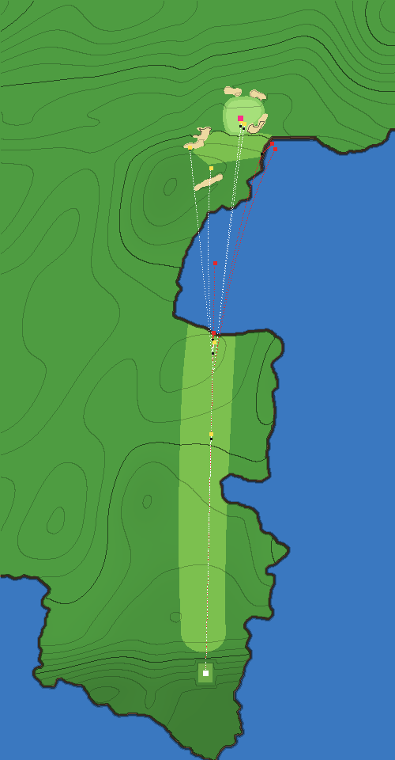

# Iconic hole spec: Pebble Beach No. 8



## 1. Inspiration

| | |
|---|---|
| Real hole | Pebble Beach Golf Links, No. 8 |
| Par / yardage (real) | Par 4, 428 yards |
| Par / yardage (game) | Par 4, **351 yards** since the OpenFairway physics (2026-10-21: the tee 25 yd forward, §6; `cards/card1.jpg`'s tag reads 351y); 376 before |
| Sources | [Golfshake hole-by-hole guide](https://www.golfshake.com/news/view/13849/Pebble_Beach_Hole_by_Hole_Guide.html) |

## 2. What makes it iconic

- **Signature features**: the drive is uphill and blind to a plateau that runs out at the cliffs; the approach is played across a chasm of ocean to a green perched on the far cliff.
- **The strategic problem**: hit the tee shot far enough to leave a manageable carry, but not so far that it runs off the end of the land; then commit to a forced carry over the sea to a small green.
- **Where scores are lost**: a drive that runs out of fairway, and an approach that comes up short.

## 3. Analysis

| Archetype | Applies? | Shot | Notes |
|---|---|---|---|
| Distance control / run-out | **primary** | tee | the plateau ends at a cliff |
| Forced carry | **primary** | approach | the chasm |
| Elevation change | yes | both | uphill drive, downhill approach |
| Green contours | yes | approach, putt | small green falling toward the front |
| Penal surrounds | yes | approach | short and right is the ocean |
| Wind exposure | yes | all | coastal |
| Risk/reward split | yes | approach | at the pin vs. around the head of the cove |

## 4. Translation

| Real feature | Game expression | Parameters | What it does to play |
|---|---|---|---|
| Uphill drive to a plateau | three `ramp`s from the 2017-18 USGS lidar, read along the fairway's left half | +6.6 yd over z −13→25 (the tee now sits partway up the climb), then +5.4 to the plateau's end | drives land sooner; a pure 3-wood stops 142 from the pin |
| Fairway runs out at the cliff | the lidar's coastline as the ocean (`poly`, `cliff` profile), read on the cliff face at 7 m | the plateau ends at z ≈ 220; the cove runs to z ≈ 295 on the line | anything that rolls past ~220 yards falls into the sea |
| Land beyond the chasm is lower | `ramp`s from the lidar | −4.2 yd to the far shore, +2.4 to the green (3.2 below the plateau), +7.2 up the hill behind | the approach plays downhill |
| Bank falling to the sea right of the green | a second ocean body brought in under the bank short-right of the green, below its front-right bunker (§5) | to about the 13 m contour | short-right that misses the bunker goes in the sea |
| Bank in front of the green | `cover` → FAIRWAY | polygon z 346–368 | closely mown, so short balls roll back to the sea instead of stopping in rough |
| Greenside bunkers | five, traced on a drone photo placed on the lidar | short by the cove, front-right (two lobes), left, back-right, back; 0.3–0.5 deep from the lidar's relief; no fairway bunkers (none in the lidar) | the front-right one catches most short-right misses |
| Small green, back to front | `green` traced on the drone photo; `tilt` from the lidar's plane over it | 22 × 21 yd (356 yd²); rises 5.1 % toward the back (the old `tilt.z` −0.03 had it falling away) | putts from above are fast; balls feed toward the front |
| Coastal wind, fast greens | `play` | wind 6–18 mph, `greens.speed` 1.1 | |

**Capability gaps**: the blind aiming rock on the real tee (no obstacle primitive yet); the real green's specific contours (approximated by tilt).

## 5. Exaggeration

| Characteristic | Real | Game | Why |
|---|---|---|---|
| Run-out off the tee | longest hitters club down | a pure driver (and a 90% one) goes into the sea; a pure 3-wood stops ~12 yd short of the edge | makes club choice the tee decision, as it is for pros. Since the OpenFairway physics (a driver rolls 10 yd on flat fairway, main 41) this needs the tee 25 yd up the hole: 351 yd against the real 428 |
| Chasm | carry over the cove | as the lidar has it (about 75 yd of sea on the line); a chunk pays | — |
| The bank right of the green | falls 12 m to the sea at about 40 % | the sea brought in to about its 13 m contour, below the front-right bunker | the game's heights run along the hole only, so the real sideways bank is flat in the game and short-right balls stayed on it; this makes short-right wet past the bunker, as it is |
| Shaved bank | rough slope | fairway-cut slope from the green to the cliff | short-right feeds into the sea |
| Downhill approach | 3.3 m (lidar) | 3.2 yd below the plateau | |

**Realism bounds** (`node tests/tools/slope.js pebble-8`, `docs/maps/pebble-8-slope.png`): the green is one tilted plane (`tilt` 3.6 %), so all of the putting surface is in the 2.5–4 % band: no steep ring (0 % over 4 %) and not a dome (tilt coherence 1.00), but the "gentle top" and "flat pockets" bounds read WARN. Deliberate: the design wants fast putts from above and balls that feed along the slope (§4), Since 2026-10-20 the green is traced and its plane is the lidar's: 5.1 % toward the back, so 99 % of the surface is over 4 % and "falloff ring" reads WARN too (no dome: coherence 0.94). Measured, not designed: the 1 m lidar resolves the plane, not the break, and this green is known for its back-to-front pitch.

## 6. Validation

All in `tests/hole-checks.js` → `pebble-8`.

| Shot | Expected |
|---|---|
| Pure driver, down the middle | water |
| 90% driver | water |
| Pure 3-wood | fairway, short of the cliff |
| Iron from (−5, 190), slight mishit (0.1) | green within 8 yd |
| Chunked iron (0.7) | water |
| Thin-right iron (0.55) lands on the shaved bank | water |
| Bail-out left around the cove (0.5 miss) | dry |

| Decision | Must hold | Result |
|---|---|---|
| Tee club: driver / 3-wood / iron | driver wet more often than not; 3-wood dry and best for both skills; iron leaves 50+ yd more | driver wet 100 % (sharp) / 62 % (shaky); 3-wood best for both (3.97 / 4.06); iron leaves 56 yd more (202 against 146) |
| Approach: pin / bail left | pin brings the sea into play for a shaky player; sharp stays dry and greens it at least 9 times in 10; bail is dry but costs 0.5+ strokes | pin wet 5 % for shaky; sharp 19 in 21 on the green, 2 in the left bunker; bail costs a sharp player 1.15 strokes |

**Check-change log**

| Check | Was | Now | Why |
|---|---|---|---|
| The approach shots and the approach strategy | from (−5, 247) | from (−5, 215) | The lidar ends the plateau at z ≈ 245, so (−5, 247) is over the sea; (−5, 215) is where the pure 3-wood now stops (161 from the pin) |
| `tests/holes.test.js` recovery test (Pebble's bunkers) | the bunker short of the raised green pays over 0.5 strokes and 3 × the one beside it | both greenside bunkers are within the lie charge (< 0.2) | The lidar has no knoll: the front-left bunker sits level with the green (floor 18.5 m, green 18.8 m), so there is no face to climb; the Road Hole bunker part of the test is unchanged |
| Approach strategy, shaky player | wet more than 5 % going at the pin | wet at least once in 21 (`> 0`) | The traced front-right bunker sits between the green and the bank, so it catches most short-right misses that the invented sea used to take: 1 in 21 now. Moving the sea in further would put it under the bunker, which the photo shows sitting on dry land |
| `tests/tools.test.js` slope bounds: the tilted-plane example | Pebble No. 8 (one plane in the 2.5–4 % band) | Augusta No. 13 (the lidar's 3.3 % plane) | Pebble's traced green tilts 5.1 % (the lidar), outside that band |
| `tests/ball.test.js` bunker-drop test | Pebble's first bunker (short-left ellipse) | Pebble's first bunker, now the traced compact one behind the green | The test samples an ellipse ring inside `BUNKERS[0]`; the irregular traced bunkers (the left one has a grass tongue) give it under six targets in sand, so the compact back bunker is listed first |
| **All shots and strategies (2026-10-21, OpenFairway physics)** | the tee at the old origin; drives aimed at (−5, 250), approaches from (−5, 215), the bail-out at (10, 356) | the tee 25 yd forward (everything moved with the land); every z 25 less: (−5, 225), (−5, 190), (10, 331) | Under OpenFairway's flight and bounce a pure driver stopped 142 yd from the pin, short of the plateau's end, and so did a 90 % one: driver against 3-wood was no choice. From +25 a pure driver, both of a sharp player's misses and a 90 % driver reach the chasm and a pure 3-wood stops 12 yd short of the edge (+20 left the 90 % driver dry; +28 put the pure 3-wood in the sea). The approaches stay on the same ground (161 yd out); a pure 3-wood now stops 19 yd nearer, at (−5.5, 209) |
| Tee club: the iron lay-up | leaves 60+ yd more than the 3-wood | leaves 50+ yd more (56: 202 against 146) | OpenFairway's roll: a 3-wood runs 9 yd on flat fairway (main 26) and an iron 7, so the gap between them fell by about 17 yd. No tee position between +20 and +30 gives 60 |
| Approach: a sharp player at the pin | hits the green every time | stays dry and holds the green at least 9 times in 10 | 19 in 21; the two most-pulled shots find the traced left bunker (−26, 342). The hole's base landform (`seed`, `roll`, `ridge`) is a function of absolute coordinates, so moving the tee re-rolls its small invented swells under the green complex; the lidar's ramps, the traced green, bunkers and coastline moved exactly. (At +22 every sharp approach held the green, but the 90 % driver was dry) |

## 7. Results

After the OpenFairway redesign (2026-10-21: the tee 25 yd forward). "before" is the hole-report baseline (commit 548d49a with the signature stripped), not the branch before this change; that comparison is in §6's log and in PR #22.

```
=== Pebble Beach (pebble-8) — Distance control off the tee (the plateau ends at a cliff), then a forced carry over an ocean chasm to a small, back-to-front green.
shot                                                                           before           after
a pure driver runs off the end of the plateau into the chasm                   FAIRWAY 90y      WATER 93y
even a 90% driver still finds the chasm                                        FAIRWAY 107y     WATER 136y
a pure 3-wood stops on the plateau, short of the cliff                         FAIRWAY 130y     FAIRWAY 142y
from there a well-struck iron carries the chasm and holds the green            FAIRWAY 26y      GREENS 4y
a chunked approach comes up short in the chasm                                 ROUGH 62y        WATER 29y
a ball short-right on the shaved bank feeds back down to the sea               ROUGH 53y        WATER 26y
the bail-out left, around the head of the cove, stays dry                      ROUGH 60y        ROUGH 36y

  strategy: tee club
  plan       skill   before: wet green score   after: wet green score
  driver     sharp           0%   0% 3.81            100%   0% 5.85
  driver     shaky           0%   0% 3.98             62%   0% 5.20
  3-wood     sharp           0%   0% 3.92              0%   0% 3.97
  3-wood     shaky           0%   0% 4.07              0%   0% 4.06
  iron       sharp           0%   0% 4.26              0%   0% 4.20
  iron       shaky           0%   0% 4.31              0%   0% 4.24

  strategy: approach line
  plan       skill   before: wet green score   after: wet green score
  pin        sharp           0%   0% 3.44              0%  90% 2.66
  pin        shaky           0%   0% 3.55              5%  38% 3.18
  bail       sharp           0%   0% 3.80              0%   0% 3.81
  bail       shaky           0%   0% 3.82              0%   0% 3.74
  payoff of pin over bail (strokes saved): sharp 0.36 → 1.15, shaky 0.27 → 0.56   (before → after)

"score" = expected strokes for the whole hole from that moment (tour-style baseline; water/OB = stroke and distance).
```

Expected strokes ("score") come from the baseline in `tests/hole-play.js`, including its recovery-difficulty term (see `docs/ICONIC-HOLES.md`). "Before" is the original hole as it stood at commit 548d49a: the same tee and pin, none of the iconic-hole features, play profile or hazards.

## 8. Review — does it look like the hole?

**Fast lane, lidar + photo** (2026-10-20). Heights, the coastline and the bunkers' depths from the lidar; the green and its five bunkers traced on a drone photo placed on the lidar.

**References used**: USGS 3DEP 1 m DEM, `CA_AZ_FEMA_R9_Lidar_2017_D18`, tile x59y405 (2017-18; not in the repo); a map pin on the green from the project owner; two drone photos from the project owner (not in the repo): `pebble-8-drone-behind.jpg` (from behind the green: traced) and `pebble-8-drone-plateau.jpg` (from the plateau's end: by eye). The behind photo is placed by a homography fitted to the five bunkers' lidar hollows: residuals 0.05–0.17 yd, and each bunker predicted from the other four lands within 2.4 yd of its hollow. The green complex is taken as one plane (3 m of relief seen from a drone well above it), so edges far from the bunkers carry a yard or two of parallax. The tee is the pad at the south-west tip of the point beside the 7th green, 386 m (422 yd; the card's 428) from the pin. Frame: `docs/holes/trace/pebble-8.json` (bearing 56.5°, 0.974 game yd per m).

**What changed**

| Item | Was | Now |
|---|---|---|
| Coastline | an invented `outside` polygon, the plateau ending at z 262 | the lidar's, read on the cliff face at 7 m: the plateau ends at z ≈ 245 |
| Heights | +5 to the plateau, −2.2 toward its end, −6 beyond the chasm, a +3 knoll under the green | from the lidar: 12 yd up to the plateau, the green 3.2 below it, the hill behind |
| Green | ellipse 26 × 22 yd, falling away 3 % | traced, 22 × 21 yd (356 yd²), rising 5.1 % to the back (lidar) |
| Greenside bunkers | two ellipses, 1.6 deep | five traced: short by the cove, front-right (two lobes), left, back-right, back; 0.3–0.5 deep |
| Fairway bunkers | two, on the plateau's end | none (the lidar has cliff there) |
| Highest hop, ten seeds (from the first touchdown) | 3.87 yd | 2.66 yd |

**Renders**: `docs/maps/pebble-8-tee.png`, `docs/maps/pebble-8-aerial.png`.

**Verdict**
- Tee and direction: **matches**.
- Heights: **matches** along the hole; the sideways bank right of the green is **can't express yet**, so the sea is brought in under it below the front-right bunker (§5).
- Green: **matches** (traced; tilt from the lidar).
- Bunkers: **matches** — five, shapes from the photo, places and depths from the lidar.
- Water and surroundings: **matches** for the coastline and the cove.

**Tee move (2026-10-21, OpenFairway physics).** The tee went 25 yd forward along the hole with everything else moving with the land, so it now sits partway up the climb: the drive is still uphill and blind over the crest, with less slope in front of the tee (`docs/maps/pebble-8-tee.png`). The real tee at the tip of the point is 25 yd behind it; the lidar frame in `docs/holes/trace/pebble-8.json` is unchanged and its `tee_shift` says to subtract 25 from z. *Tee and direction* is now **differs on purpose** (§5) for the yardage, **matches** for the line.

**Open items**
1. From where a pure 3-wood now stops (−5.5, 209), 142 yd out, a thin-right iron (0.55) finishes on the shaved bank, dry (from the checks' (−5, 190) it feeds to the sea). The bank and the sea under it are tuned for the longer approach; worth a look when the approach is next touched.
2. A sideways height primitive (a bank across the hole), so the real fall to the sea right of the green replaces the moved shoreline.

### Earlier review-only pass


**Review-only pass, no reference image yet** (2026-10-19). The verdicts below compare the game's renders (`python3 tests/tools/render.py pebble-8 tee bird approach green aerial`; the green-complex view is committed as `docs/maps/pebble-8-aerial.png`) with this spec's sources and what is widely known of the hole. Nothing here was traced, so no shape is measured: "close" means the parts are there and in the right places, not that their sizes are right, and every **no reference** row waits for a photo. The step and its tools: `docs/ICONIC-HOLES.md` §2, step 7.

**Photos to get**: an aerial of the green across the chasm from the end of the fairway (the shot that decides the hole), and one from the tee up the hill.

| Area | Item | Verdict | Evidence (render against sources) | Action / missing primitive |
|---|---|---|---|---|
| Tee placement and elevation | Tee position and line to the green | **close** | The drive climbs to a plateau that ends at the cliff, as the spec says; the game's tee box faces straight up the hole | — |
| | Elevation: tee, landing area, green | **close** | Uphill to the plateau (+5 yd), down across the chasm (−6 yd) to a green raised on its own knoll (+3 yd); the sources give no heights, so the sizes are guesses | Heights from a topographic source |
| | Ground between | **close** | The plateau tips toward the edge; in the render the fairway runs out at the rock face | — |
| Fairway and fairway bunkers | Fairway outline and width | **close** | One strip ending at the cliff | — |
| | Fairway bunkers: count, place, shape | **no reference** | Two in the game short of the plateau's end, one each side | A photo up the fairway |
| | Rough, waste, paths | **close** | Cypress-and-ice-plant coast rough | — |
| Green and greenside bunkers | Green outline and size | **differs: fix** | A 26 × 22 yd ellipse; the real green is small and not an ellipse | Trace it from the aerial: expressible now (`green:{pts}`) |
| | Green contours as seen | **no reference** | One back-to-front tilt | — |
| | Greenside bunkers: count, place, shape, depth | **no reference** | Two ellipses, front-left and back-right of the green | Trace from the aerial |
| | Collar, banks and falloffs | **close** | A shaved bank in front of the green runs short balls back to the sea; the knoll falls away on every side | — |
| Surroundings and landmarks | Trees: kind and where | **close** | Cypress and pines along the sides | — |
| | Water, cliffs, structures, backdrop | **matches** in kind | The ocean inlet cut into the cliff line, rock faces in bands, rocks in the surf: the hole's look | Measure the inlet's shape from the aerial |
| | Landmarks a player would name | **can't express yet** | The blind tee shot's aiming rock (spec §4) | A scenery prop that also marks a line (an aiming post or rock), or a blind-shot primitive |

**Open items**, most important first:
1. Trace the green and its bunkers from an aerial: the outline is expressible now, and it is the shot the hole is about.
2. The aiming rock on the blind drive: needs a prop (and blind shots, shared with St Andrews No. 17).
3. Heights for the climb, the chasm and the green's knoll.
