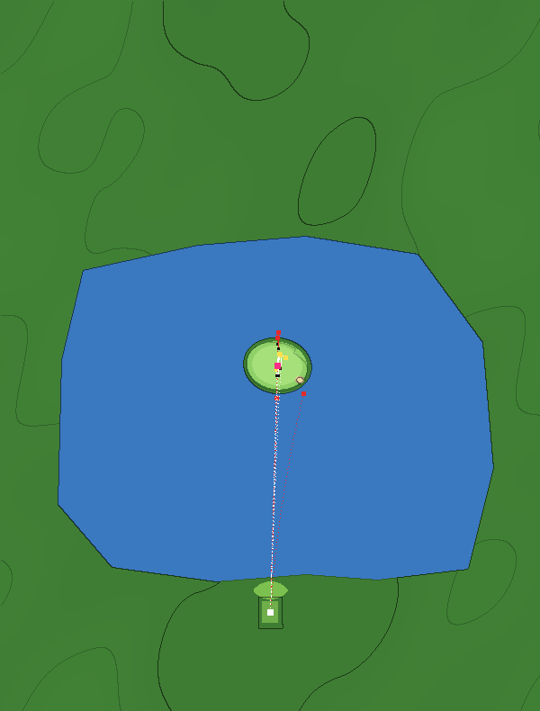

# Iconic hole spec: TPC Sawgrass No. 17



## 1. Inspiration

| | |
|---|---|
| Real hole | TPC Sawgrass (Stadium Course), No. 17 — the island green |
| Par / yardage (real) | Par 3, about 137–141 yards depending on the day |
| Par / yardage (game) | Par 3, 137 yards |
| Sources | [The Golf News Net: size of the island green](https://thegolfnewsnet.com/ryan_ballengee/2026/03/14/what-is-the-size-of-the-island-green-par-3-17th-hole-at-tpc-sawgrass-and-the-players-125558/) |

## 2. What makes it iconic

- **Signature features**: a green that is almost entirely surrounded by water, about 78 × 81 feet; a small pot bunker; a walkway to the mainland.
- **The strategic problem**: there is no bail-out. Short, long, left or right is usually wet, so the shot is pure distance and direction control — and the wind decides what "the right distance" is.

## 3. Analysis

| Archetype | Applies? | Shot | Notes |
|---|---|---|---|
| Penal surrounds (island) | **primary** | tee | |
| Wind exposure | **primary** | tee | the variable the player has to read |
| Deep bunker | yes | tee | the one dry miss, and a hard one |
| Green contours | yes | putt | |

## 4. Translation

| Real feature | Game expression | Parameters | What it does to play |
|---|---|---|---|
| Island green | water body (`lake`, `wall` bulkhead) with an island; green 28 × 22 yd (about the real size) | unchanged from before | |
| Little margin around the green | `rise` (crown) | +0.9 yd over the island, edge 6 | the strip around the green slopes down to the bulkhead, so marginal shots run toward the water |
| Tier in the green | `step` | line through the green, back-left +0.45 yd | the pin sits on the lower front-right level; long putts climb or fall a ridge |
| Pot bunker | bunker | `depth 1.5, lip 0.4` | |
| Exposed, swirling wind | `play` | wind 7–19 mph, `windPush` 3 (HUD: GUSTY) | the arc shows still air; the player must read the wind |

**Capability gaps**: the walkway; the swirl itself (wind is constant during a shot).

## 5. Exaggeration

| Characteristic | Real | Game | Why |
|---|---|---|---|
| Wind effect | strong, swirling | 3× the ball's normal wind response | with our drag model a 15 mph cross only moved a 137-yd iron ~2 yd; reading the wind has to matter |
| Shedding margin | collar and rough | crowned strip falls to the bulkhead | a "just off" shot should still be in danger |
| Green tier | (invented) | 0.45-yd step | gives the putting surface a feature; labelled as an arcade invention |

**Realism bounds** (`node tests/tools/slope.js sawgrass-17`, `docs/maps/sawgrass-17-slope.png`): 0 / 82 / 1 / 16 % in the four bands. The 16 % over 4 % is the ridge of the invented tier (a 0.45 yd step over 3.5 yd), well inside the ~35 % ring bound; the rest is a 1.3 % tilt, so there are no flat pockets (WARN). The tier is already labelled an arcade invention above; the green is not where this hole is decided.

## 6. Validation

All in `tests/hole-checks.js` → `sawgrass-17`.

| Shot | Expected | Result |
|---|---|---|
| Well-struck iron (0.1) | green within 8 yd | ✅ 6 yd |
| Carried 12 yd long | water | ✅ |
| Bad miss right (0.6) | water | ✅ |
| Stock shot into a 17 mph following wind | water | ✅ (was rough) |
| Land it short into the same wind | green | ✅ |
| Stock shot to a front pin into a 17 mph headwind | water | ✅ (was green) |
| Arc 11 yd past the pin into that headwind | green within 6 yd | ✅ 2 yd |

| Decision | Must hold | Result (wet %, expected score) |
|---|---|---|
| Reading a following wind: stock vs read | stock is a disaster even for a sharp player; reading keeps a sharp player dry and saves strokes | stock: sharp 86% / 4.72, shaky 33% / 3.91 · read: sharp 0% / 2.76, shaky 38% / 3.65 |
| Skill in still air | sharp always dry; shaky wet at least 1 in 7 | sharp 0%, shaky 19% |

## 7. Results

```
=== TPC Sawgrass (sawgrass-17) — Pure distance and direction control to an island green, with the wind as the hidden variable.
shot                                                                           before           after
a well-struck iron holds the green                                             GREENS 7y        GREENS 6y
a shot carried 12 yards long runs off the back of the island into the water    WATER 18y        WATER 16y
a bad miss right is wet                                                        WATER 22y        WATER 21y
ignore a 17 mph tailwind and the ball flies the green into the water           ROUGH 13y        WATER 18y
play the tailwind (land it short) and it finishes on the green                 GREENS 2y        GREENS 6y
into a 17 mph headwind, a stock shot to a front pin comes up short and wet     GREENS 7y        WATER 18y
into the same headwind, aiming the arc 11 yards past the pin finds the green   FRINGE 11y       GREENS 2y

  strategy: reading a following wind
  plan       skill   before: wet green score   after: wet green score
  stock      sharp           0%  24% 3.19             86%   0% 4.72
  stock      shaky          10%  52% 3.30             33%  14% 3.93
  read       sharp           0%  71% 2.81              0% 100% 2.76
  read       shaky          57%  24% 4.07             38%  52% 3.65
  payoff of stock over read (strokes saved): sharp -0.38 → -1.96, shaky 0.78 → -0.28   (before → after)

  strategy: skill matters
  plan       skill   before: wet green score   after: wet green score
  pin        sharp           0% 100% 2.76              0% 100% 2.78
  pin        shaky          19%  71% 3.23             19%  71% 3.29
```

Expected strokes ("score") come from the baseline in `tests/hole-play.js`, including its recovery-difficulty term (see `docs/ICONIC-HOLES.md`). "Before" is the original hole as it stood at commit 548d49a: the same tee and pin, none of the iconic-hole features, play profile or hazards.
